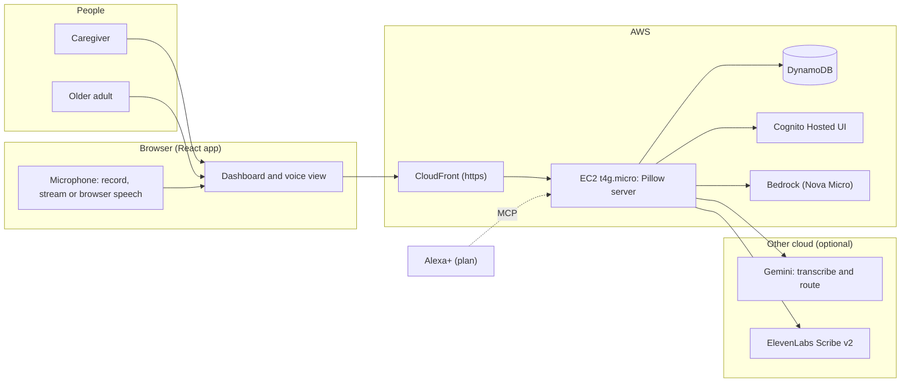
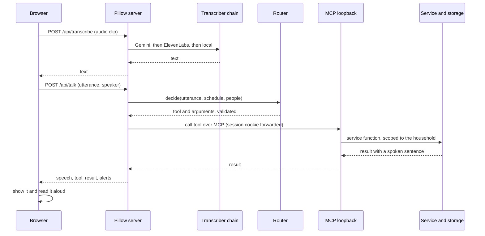
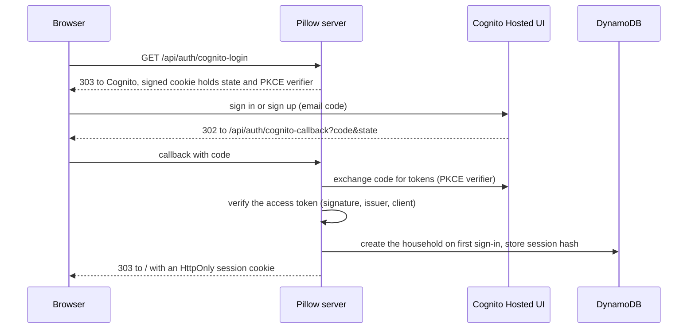
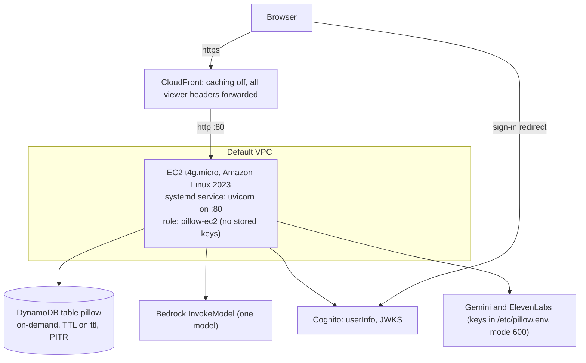
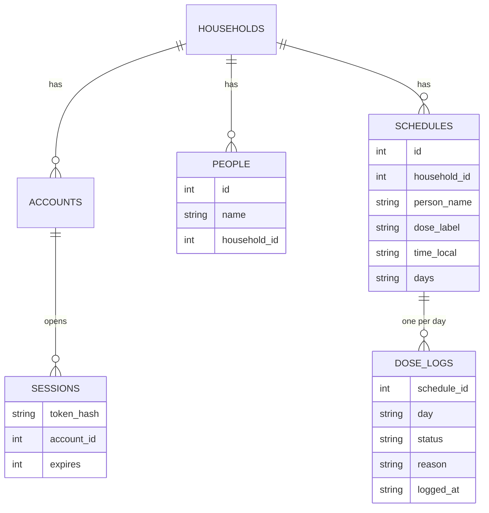
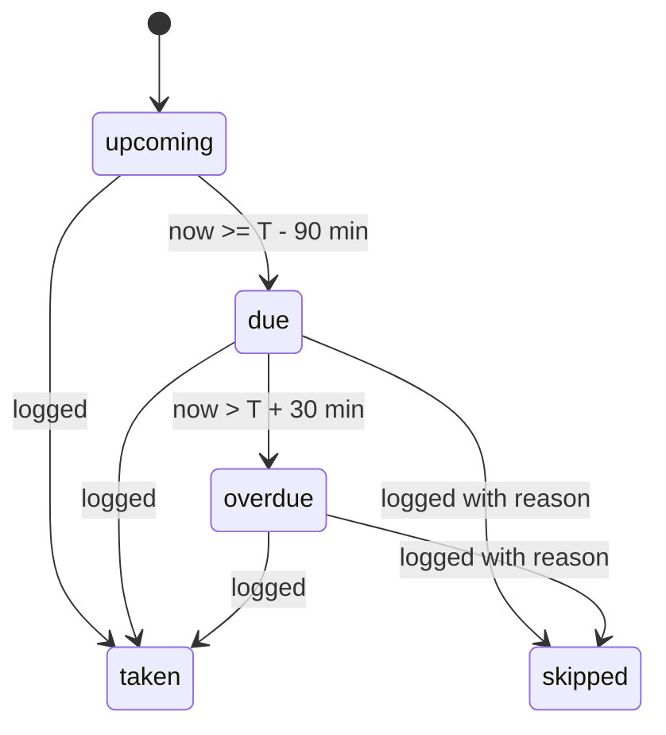

# Pillow: design document

A spoken household medicine log. A caregiver sets up each person's medicines once; anyone in the family then logs doses and asks questions by voice or text, and everyone sees one shared record. The core is a self-hosted MCP server, the interface Alexa+ uses to call tools.

This document has two halves: the **high-level design** (what the parts are and how they fit) and the **low-level design** (modules, data, algorithms, APIs). Diagrams use Mermaid, which GitHub renders.

Status words used throughout: **built** (in the repo and tested), **opt-in** (built, off unless configured), **plan** (not built).

---

## 1. Goals and non-goals

**Goals**
- Log and ask about doses in plain spoken or typed sentences, for several people in one household.
- Per-person schedules with times and weekdays, and a shared record everyone sees.
- A reminder ten minutes before each dose, and a visible alert when a dose is overdue.
- One tool per action behind an MCP server, so a voice assistant can drive it.
- Keep working when any cloud service is slow, out of quota or offline.
- Run on very little compute (one small instance).

**Non-goals**
- No diagnosis, dosing advice, prescription changes or pharmacy links. It is a log.
- No voice biometrics: the speaker confirms whose dose it is by name.
- Real Alexa+ delivery, photo-to-medicines and separate family sign-ins are **plan**, not built.

---

# Part 1. High-level design

## 2. System context



## 3. Components

| Component | What it is | Where |
| --- | --- | --- |
| Web app | React 18 + Vite single-page app: dashboard, voice view, sign-in | `frontend/` (built to `web/dist`) |
| API server | Starlette app on Uvicorn, one process | `src/dose_check/server.py` |
| MCP server | Official Python MCP SDK, Streamable HTTP, stateless JSON, 11 tools, mounted on the same app at `/mcp` | `server.py` |
| Domain logic | Dose rules, schedules, reminders, spoken sentences | `service.py`, `logic.py` |
| Intent router | Turns one sentence into one tool call (LLM first, rules as fallback) | `agent.py`, `intent.py`, `gemini.py` |
| Speech to text | Chain of Gemini, ElevenLabs and local Whisper, plus a live relay | `transcribe.py`, `gemini.py`, `live.py` |
| Storage | SQLite (default) or DynamoDB (single table) behind the same methods | `db.py`, `dynamo.py` |
| Identity | Local passwords, demo mode, or Cognito Hosted UI | `auth.py` |

## 4. Technology choices

| Area | Choice | Reason |
| --- | --- | --- |
| Interface for Alexa+ | MCP 2025-11-25 over Streamable HTTP | Required by the track; one tool per action |
| Backend | Python, Starlette, Uvicorn (1 worker) | Small, async, official MCP SDK |
| Frontend | React + Vite, plain CSS | Fast build, no UI framework needed |
| Storage | SQLite locally, DynamoDB on AWS | No server to run; pay per request |
| Sign-in | Cognito Hosted UI (authorization code + PKCE) | No passwords stored by us |
| HTTPS | CloudFront in front of EC2 | Free https address; the microphone needs a secure origin |
| Action choice | Gemini function calling, Bedrock, then local rules | Closest-tool mapping with a safe fallback |
| Voice | Gemini 3.5 Transcribe, ElevenLabs Scribe v2, faster-whisper, browser engine | Each is a fallback for the one before |

## 5. Main flows

### 5.1 A spoken or typed command



The app calls its own MCP endpoint for every action, so the same path an Alexa+ client would use is exercised on every request.

### 5.2 Sign-in with Cognito



### 5.3 Reminder ten minutes before a dose

The browser polls `GET /api/reminders` every 20 seconds and after each change. The server returns today's unlogged doses starting within the next 10 minutes, worded for speaking, for example "Mom's lisinopril is due at 8 AM, in 10 minutes." The page shows a banner and reads it aloud, once per dose per day. Delivery through Alexa+ proactive notifications is **plan** (EventBridge Scheduler, then SNS).

## 6. Deployment architecture (AWS)



Created by `deploy/aws.yaml` (table, role and instance profile, CloudFront distribution, Cognito pool, domain and client). The instance is created by hand. `deploy/deploy.sh` copies the app over SSH and restarts the service. About $10 a month at this size.

## 7. Non-functional design

| Concern | Approach |
| --- | --- |
| Availability | Every cloud call has a fallback (see 7.1). systemd restarts the process on failure. |
| Latency | Common phrases resolve in the rules instantly; the LLM adds 1 to 10 seconds. Microphone is kept warm for 15 s so Speak starts at once. |
| Cost | One tiny instance, DynamoDB on-demand, CloudFront free tier; cloud voice and LLM calls are optional and rate limited by cooldowns. |
| Security | See section 11. |
| Privacy | Audio goes to a cloud service only if a key is set. With no keys it never leaves the machine. |
| Scalability | Single worker, designed for a few households. DynamoDB removes the single-file limit; scaling out needs only more instances. |
| Observability | Uvicorn and systemd logs (`journalctl -u pillow`). `/api/health` reports storage, auth, router and transcription provider. |

### 7.1 Failure handling

| Failure | What happens |
| --- | --- |
| Gemini out of quota or overloaded | Skipped for 10 minutes after a quota error; falls to Bedrock, then rules |
| Bedrock throttled | Single attempt, no retries; falls to the rules |
| ElevenLabs rate limited | One retry after 2 s, then skipped for 60 s; falls to Gemini or local |
| All cloud transcription fails | The page switches to the browser's speech recognition for two minutes and asks the user to repeat |
| Live transcription fails | Page falls back to record-and-upload |
| Unknown or invalid LLM output | Validated against each tool's JSON schema; on any mismatch the rules decide |
| Missing frontend build | Pages return 503 with the build command |

---

# Part 2. Low-level design

## 8. Repository layout

```
src/dose_check/
  server.py     routes, MCP tools, middleware wiring, store selection
  service.py    all dose logic and spoken sentences (pure functions over a store)
  logic.py      clock math, due/overdue states, weekday parsing
  intent.py     local rules: sentence to tool and arguments
  agent.py      routing order, tool specs, argument validation, Bedrock call
  gemini.py     Gemini transcription, live session, function-calling router
  transcribe.py provider chain, cooldowns, ElevenLabs and local Whisper
  live.py       WebSocket relay to Gemini Live
  auth.py       local sessions, demo mode, Cognito flow, household middleware
  db.py         SQLite store          dynamo.py   DynamoDB store
  mcp_client.py MCP client used by /api/talk
  speech.py     optional Bedrock rephrase of replies
frontend/src/   pages, components, hooks, api.js, styles (React)
frontend/public/ listener.js, recorder.js, live.js, mic.js, pcm-worklet.js, brand/
deploy/         aws.yaml, deploy.sh, pillow.service, env example, README
tests/          pytest, Node, and (in frontend/) Vitest
```

## 9. Data model

### 9.1 SQLite (default)



- `time_local` is `HH:MM` in the server's local time zone. `days` is a comma list of weekday numbers, Monday = 0 (`0,1,2,3,4,5,6` means every day).
- `dose_logs` is unique on `(schedule_id, day)`: logging again overwrites.
- A person exists if registered or if any schedule names them.
- Every query is scoped by `household_id`; ids from another household are rejected.

### 9.2 DynamoDB (single table `pillow`, on-demand)

| Item | `pk` | `sk` | Attributes |
| --- | --- | --- | --- |
| Person | `H#<household>` | `P#<name lower>` | name |
| Schedule | `H#<household>` | `S#<id, 12 digits>` | id, person_name, dose_label, time_local, days |
| Log entry | `H#<household>` | `L#<day>#<schedule id>` | schedule_id, day, status, reason, logged_at |
| Counter | `META` | `SEQ#schedule` or `SEQ#household` | n (atomic ADD) |
| Account | `SUB#<cognito sub>` | `ACCOUNT` | email, household_id, household_name |
| Session | `SESSION#<token hash>` | `SESSION` | sub, ttl (expiry; DynamoDB TTL removes it) |

All household reads are `Query` on `pk` with a `begins_with(sk)` prefix; no scans. `DynamoStore` exposes the same methods as `Store`, so `service.py` is storage-agnostic.

## 10. Core algorithms

### 10.1 Dose states (`logic.py`)

For a dose scheduled at `T` on a day it applies to:



A logged status always wins. Overdue doses appear as family alerts (`minutes_late` counts from the end of the 30-minute grace window). Doses whose `days` exclude today are not on today's board.

### 10.2 Reminders (`service.upcoming_reminders`)

For each dose in `due` or `upcoming` state with no log, `minutes = ceil((T - now) / 60)`. Include it when `0 < minutes <= lead` (default 10). Sorted by time, with a ready sentence per item. The front end remembers announced `scheduleId + date` pairs in `sessionStorage`.

### 10.3 Choosing the action (`agent.decide`)

1. Strip speaker-mode phrases ("switch to caregiver mode"); mode changes never grant permissions.
2. If Gemini routing is on: send the sentence, the known people and the schedule, plus the 11 tool declarations. Take the first function call.
3. Validate the call against that tool's JSON schema (`additionalProperties: false`). On any error, drop it.
4. If `AGENT_BEDROCK_FIRST=1` and Bedrock is enabled, ask Bedrock the same question the same way.
5. Otherwise, or if nothing was chosen: the local rules in `intent.py`.
6. If still nothing and Bedrock is enabled (not first): ask Bedrock.
7. If nothing applies: reply with help text and call no tool.

The reply carries `router` (`gemini`, `bedrock`, `rules`) for transparency.

### 10.4 Local rules (`intent.py`)

Ordered regular-expression rules, tuned on real speech mistakes: `normalize_hearing` repairs common mishearings and possessives ("Mom's" becomes "Mom"); a day-phrase extractor ("on Monday and Friday", "weekdays") is lifted out first; then register, remove, change, add (several word orders), taken/skipped, status, list, summarize, clear and due. Rules never invent a person or medicine; known people and labels come from the household.

### 10.5 Transcription chain (`transcribe.py`)

Order: Gemini (if a key is set and not paused), ElevenLabs (if a key is set and not paused), local faster-whisper (if installed). `DOSE_TRANSCRIBE_PROVIDER` puts one first or forces `local`. Custom vocabulary (people, medicines, common drugs) is sent as hints. The first provider to return text wins; any failure moves to the next.

### 10.6 Spoken replies (`service.py`)

Every service function returns a `speech` sentence built from data, never from a model: "Mom took the 8 AM lisinopril.", "Raj's 9 AM dopamine is overdue." An optional Bedrock pass can rephrase it (`SPEAK_WITH_BEDROCK`), and a failed pass keeps the template.

## 11. Security design

| Area | Design |
| --- | --- |
| Household isolation | Identity (a verified session or token) sets a context variable; the store is scoped from it on every request, REST and MCP alike. No household id is accepted from a body, a model or a token claim. |
| Local passwords | PBKDF2-SHA256, 600,000 iterations, per-user salt; at most 10 attempts per email per 15 minutes |
| Sessions | Random 256-bit token; only its SHA-256 is stored; HttpOnly, SameSite=Strict, Secure behind https; 12 hours |
| Cognito | Authorization code with PKCE; state and verifier in an HMAC-signed, HttpOnly, Lax cookie; token signature, issuer, `token_use=access` and client id verified; a first sign-in creates its own empty household |
| Bearer tokens | Accepted for API and MCP clients only when an administrator mapped the Cognito `sub` to a household |
| CSRF | Writes whose `Origin` host differs from the request `Host` get 403; WebSocket upgrades are origin checked too |
| MCP transport | DNS-rebinding protection with an allow-list: loopback names, plus `DOSE_PUBLIC_HOST` |
| Secrets | Server keys live in `/etc/pillow.env` (root, mode 600); the instance role grants only the one table and one Bedrock model; nothing secret is in git |
| Input handling | Tool arguments validated by JSON schema; names title-cased and trimmed; times validated as `HH:MM`; audio limited to 8 MB |

## 12. API reference

### 12.1 REST

| Method and path | Purpose |
| --- | --- |
| `POST /api/talk` | Body `{utterance, speaker}`; chooses and calls a tool; returns speech, tool, arguments, result |
| `GET /api/today` | Today's doses, alerts, people and the full schedule |
| `GET /api/reminders` | Doses starting within the next `lead` minutes (default 10) |
| `POST /api/people`, `DELETE /api/people/{name}` | Add or remove a person (and their medicines) |
| `GET/POST /api/schedules`, `PUT/DELETE /api/schedules/{id}` | Manage medicine times |
| `POST /api/logs/reset` | Clear the day's log |
| `POST /api/transcribe` | Audio in, text out (provider chain) |
| `WS /api/transcribe/live` | Streaming relay to Gemini Live (opt-in) |
| `GET /api/auth/session`, `POST /api/auth/{login,register,logout}` | Local sessions |
| `GET /api/auth/cognito-login`, `GET /api/auth/cognito-callback` | Cognito Hosted UI flow |
| `GET /api/health` | Capabilities: storage, auth, router, transcription, tool list |
| `/mcp` | MCP endpoint (needs a session cookie or approved Bearer token) |

### 12.2 MCP tools

| Tool | Arguments | Effect |
| --- | --- | --- |
| `list_due_doses` | person_name? | Doses due now, overdue, and the next one |
| `log_dose` | status (taken or skipped), person_name?, dose_label?, time_hint?, reason? | Record a dose for today |
| `dose_status` | person_name?, dose_label?, time_hint? | Whether a dose was taken, skipped, due, overdue or later |
| `summarize_day` | person_name? | One sentence per dose for today |
| `register_person` | name | Add a person |
| `add_medicine` | person_name, dose_label, times (HH:MM list), days? | Add times; merges days if it already exists |
| `remove_medicine` | person_name?, dose_label?, time_hint? | Remove matching times; asks when ambiguous |
| `change_medicine` | person_name, dose_label, times?, days? | Replace times and or days |
| `list_medicines` | person_name? | What each person takes, when and on which days |
| `clear_today_log` | person_name? | Remove today's taken and skipped entries |
| `remove_person` | name | Remove a person and all their medicines |

`time_hint` is `morning`, `afternoon`, `evening`, `tonight`, `night` or `HH:MM`. `days` accepts `mon,wed,fri`, `weekdays`, `weekends`, `daily`.

## 13. Frontend design

- **Pages:** Dashboard (people, chat, Today), Agent (voice orb), Login. The route comes from the URL; the server serves the same `index.html` for `/`, `/agent` and `/login`.
- **State:** component state and hooks only; one `api.js` wraps every call.
- **Voice stack (`AutoListener`):** prefers live streaming, then record-and-upload, then the browser's own recognizer, switching down for a couple of minutes when a stage fails.
- **Microphone pool (`mic.js`):** opens the microphone when the pointer reaches Speak and keeps it 15 seconds, so starting is instant; honest status text ("Starting microphone", "Listening").
- **Dialogs:** native `<dialog>` for add person, a person's medicines and the medicine form.
- **Reminders:** `useReminders` polls and announces once per dose per day.

## 14. Configuration

| Variable | Meaning |
| --- | --- |
| `AWS_ENABLED` | Global switch for every AWS call; off by default |
| `DOSE_STORAGE` | `sqlite` (default) or `dynamodb`; with `DYNAMODB_TABLE`, `AWS_REGION` |
| `DOSE_AUTH_PROVIDER` | `local`, `demo`, or `cognito`; with `COGNITO_USER_POOL_ID`, `COGNITO_CLIENT_ID`, `COGNITO_DOMAIN`, `COGNITO_REDIRECT_URI`, `DOSE_SECRET` |
| `DOSE_COOKIE_SECURE` | Force the Secure flag behind CloudFront |
| `DOSE_PUBLIC_HOST`, `DOSE_INTERNAL_PORT` | Public host for MCP; the port the app uses to call itself |
| `AGENT_WITH_BEDROCK`, `AGENT_BEDROCK_FIRST`, `BEDROCK_MODEL_ID`, `SPEAK_WITH_BEDROCK` | Bedrock routing and rephrasing |
| `GEMINI_API_KEY`, `GEMINI_MODEL`, `GEMINI_ROUTING`, `GEMINI_LIVE` | Gemini transcription, routing and live relay |
| `ELEVENLABS_API_KEY`, `ELEVENLABS_KEYTERMS` | ElevenLabs Scribe v2 |
| `DOSE_TRANSCRIBE`, `DOSE_TRANSCRIBE_PROVIDER`, `WHISPER_MODEL` | Transcription selection and local model |

## 15. Testing

| Layer | Tooling | Covers |
| --- | --- | --- |
| Python | pytest (about 120 tests) | dose rules, intent rules, agent routing and fallbacks, auth, Cognito flow, DynamoDB store (moto), MCP over a real subprocess, transcription chain, reminders |
| Browser scripts | Node test runner | the listener, recorder, live streamer and microphone pool with mocked audio |
| React | Vitest + Testing Library | dashboard, dialogs, reminders, sign-in |
| Infrastructure | cfn-lint, DynamoDB Local (Docker) | the CloudFormation template and the real DynamoDB engine |
| CI | GitHub Actions | runs pytest on every pull request |

Not yet tested against a live AWS account in CI; the deployed system was exercised by hand.

## 16. Known limits

- Bedrock can be throttled on a new AWS account (a small daily token cap); the rules cover that.
- Gemini's response time is 1 to 10 seconds; the rules answer common phrases instantly.
- One server process and one time zone (the server's) per deployment.
- Two sign-in styles cannot be mixed in one deployment (local passwords need SQLite; Cognito uses DynamoDB).
- The frontend build is not part of CI yet (needs the workflow permission).

## 17. Roadmap

| Item | Approach |
| --- | --- |
| Alexa+ delivery of reminders | EventBridge Scheduler per dose, SNS to an Alexa skill or proactive event |
| Photo to medicines | Upload to S3, Textract (or a Bedrock vision model) to extract, then confirm with the user |
| Several sign-ins per household | Invite flow that maps more Cognito `sub` values to one household |
| Speech to text on AWS | Amazon Transcribe as one more provider in the chain |
| Per-user limits | Rate limit voice and LLM calls per household |
| Time zones | Store a time zone per household |
